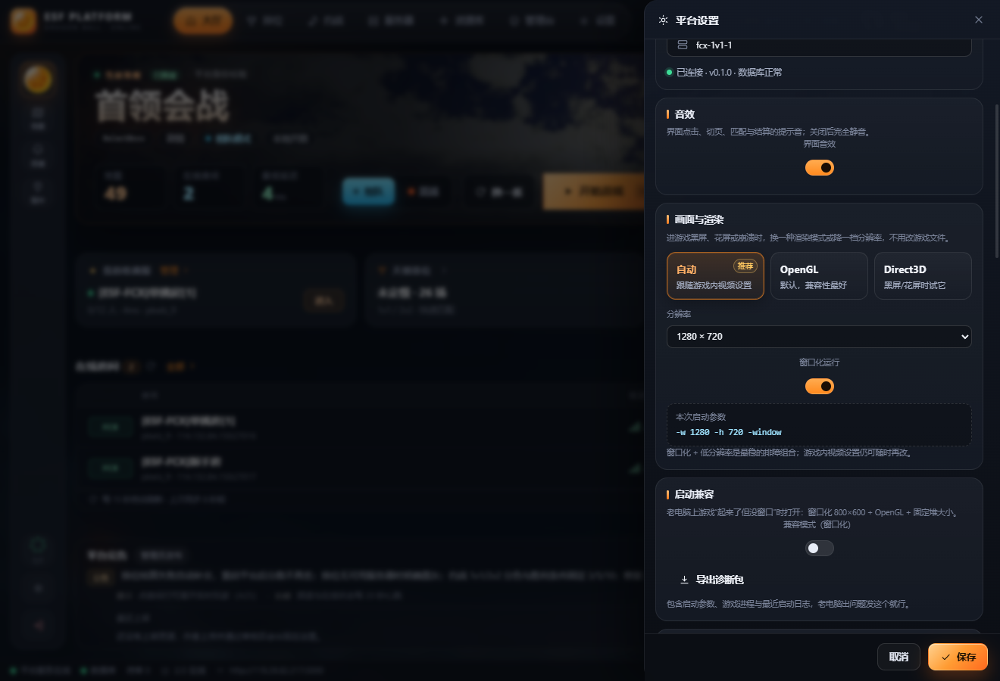
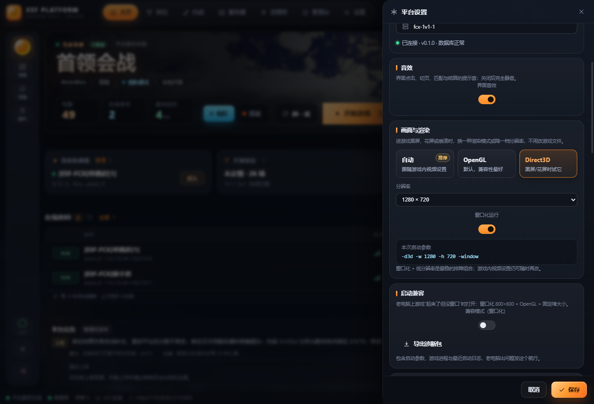

# 画面与渲染：一页说清

进游戏黑屏、花屏、闪退，九成是渲染路径或分辨率不匹配。这个功能的做法是：**不碰游戏文件，只在启动参数上做选择**。

## 放在哪里

设置抽屉新增一段「画面与渲染」，位置在「音效」之后、「启动兼容」之前。

理由很简单：它和「启动兼容」是同一类排障动作，放在一起，用户出问题时从上往下读一遍就能找到；主界面不加任何按钮，不打扰正常玩家。

## 三个选择，一眼看懂

| 选项 | 传什么参数 | 什么时候用 |
| --- | --- | --- |
| 自动（推荐） | 不传 | 默认，跟随游戏内视频设置 |
| OpenGL | `-gl` | 兼容性最好，绝大多数机器 |
| Direct3D | `-d3d` | OpenGL 黑屏/花屏时换它 |

分辨率是「跟随游戏内设置 + 常用档位 + 当前屏幕」，窗口化是独立开关。三样都即时保存，下面会实时显示「本次启动参数」，所见即所得。

## 它怎么生效

启动游戏时按顺序拼参数：

1. 平台基础参数：`-game esf +exec launcher.cfg +connect …`
2. 渲染参数：`-d3d -w 1280 -h 720 -window`
3. 若开了「启动兼容」，兼容预设里与显式选择冲突的 `-gl / -window / -w / -h` 会被移除，**用户的选择优先**
4. 新引擎（ESF Engine 1.0）下同样写进 `engine.cfg` 的 `Launcher=` 行，退出时还原

## 验证记录（本机实测）

| 项目 | 结果 |
| --- | --- |
| 设置保存 | `renderMode=d3d, 1280×720, windowed=true` 写入测试 profile |
| 启动日志 | `args=["-game","esf",…,"-d3d","-w","1280","-h","720","-window"]` |
| 游戏窗口 | `no_hl.exe` 标题 `ESF:FCX`，外框 1296×759（客户区 1280×720，含边框与标题栏） |
| 回退 | 选择「自动」时不传任何显示参数，恢复游戏内设置 |

## 边界

- 只改「这一次启动」的参数，不写注册表、不改 `config.cfg`；游戏内仍可随时调视频设置。
- Direct3D 是老的 D3D 渲染路径，主要用于排障；正常机器建议停在「自动」或 OpenGL。
- 下一步可选：加一个「启动测试」按钮（启动后 10 秒无窗口自动提示回退），以及一键「安全模式」（窗口化 800×600 + OpenGL）。
