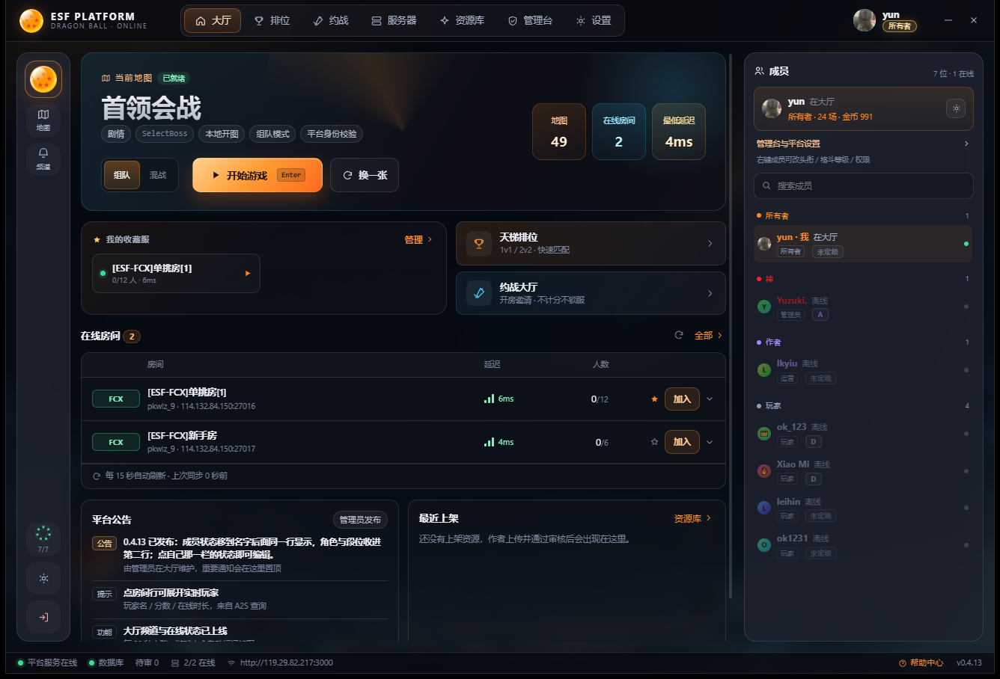
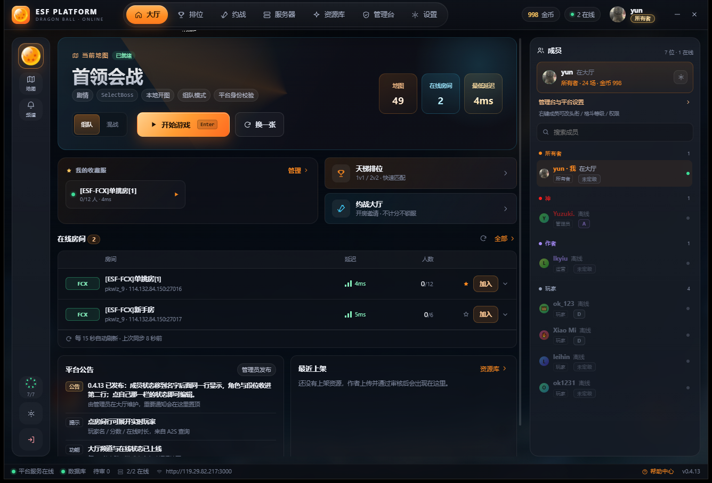

# P1 · 外壳改造

一句话：**布局一行没动，只换了外面那层壳。** 顶栏从"后台菜单"变成"游戏启动器的品牌条"，左侧从一列玻璃块收成一条 rail，状态栏减噪。所有改动都是覆盖式 CSS + 两个 props，随时可以单点回滚。

## 改了什么

- **标题栏**：56px 渐变底 + 1px 内描边；品牌徽章 34px、橙金渐变 + 内高光，右侧双行字（ESF PLATFORM / DRAGON BALL · ONLINE）
- **导航**：胶囊容器包住所有 tab，选中项是整块橙金渐变 + 深色字 + 外发光，不是以前的"淡橙描边"
- **顶栏右侧**：新增金币、在线两枚胶囊，接的是真实数据（`coins`、`onlineServers.length`）
- **左侧 rail**：48px 方块、14px 圆角，选中态渐变 + 发光；工具项压到 44px
- **状态栏**：底色收到 `rgba(11,14,20,.88)`，间距 14px，图标降透明度

## 为什么这样改

1. **导航是模式切换，不是菜单。** 玩家在"大厅 / 排位 / 约战"之间跳，需要一眼看到"我在哪"，整块橙色比边框高亮更容易扫读。
2. **金币和在线是玩家最关心的两个数。** 放在顶栏右侧常驻，比塞进侧栏或底部更符合游戏客户端的习惯。
3. **外壳要沉，内容才亮。** 顶栏、rail、状态栏都降到同一层表面色，把对比度留给大厅里的地图、房间和公告。

## 代码落点

| 文件 | 改动 |
| --- | --- |
| `src/styles/tokens.css` | P0 建立的全部设计令牌（色板/圆角/字号/间距/动效） |
| `src/App.css` | 末尾新增「P1 · 外壳」覆盖段，约 160 行 |
| `src/components/TitleBar.jsx` | 新增 `coins` / `online` props，渲染 `.tb-chips` |
| `src/components/Lobby.jsx` | 给 `TitleBar` 传 `coins` 与 `onlineServers.length` |

## 前后对比

改造前（0.4.13 线上版）：导航是描边高亮，顶栏右侧只有用户胶囊。

改造后（P1，真实客户端截图）：整块橙色选中态、金币与在线胶囊、rail 选中发光。

## 验收清单

- [ ] 导航选中项是整块橙金，深色字清晰可读
- [ ] 顶栏右侧显示金币与在线人数，数值随大厅刷新
- [ ] 左侧 rail 选中态有渐变与发光，未选中项不过亮
- [ ] 窗口拖拽、最小化、关闭都正常（无边框窗口的自定义按钮）
- [ ] 最小宽度 1180px 下导航不换行、不溢出

## 下一步

P2 动大厅内容：hero 区的信息层级、快捷三卡（收藏服 / 天梯 / 约战）、在线房间表、公告与最近上架。外壳定了，接下来每一屏都在这套壳里做。
