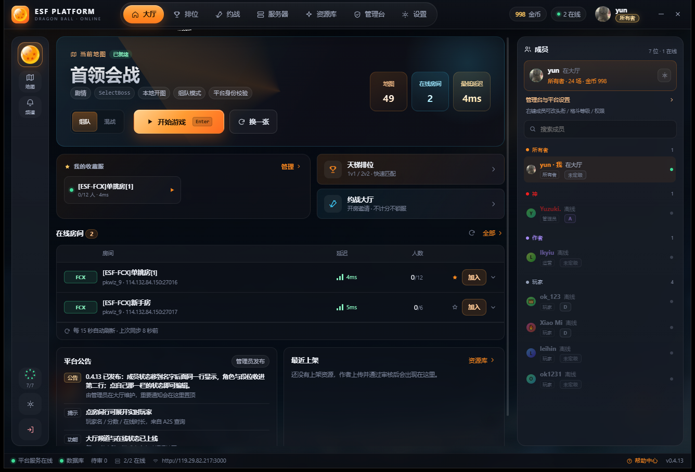
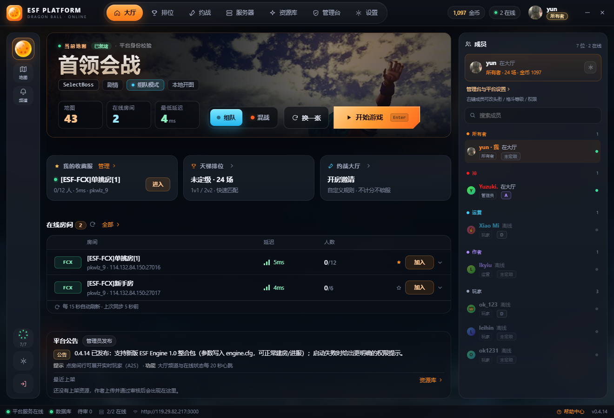
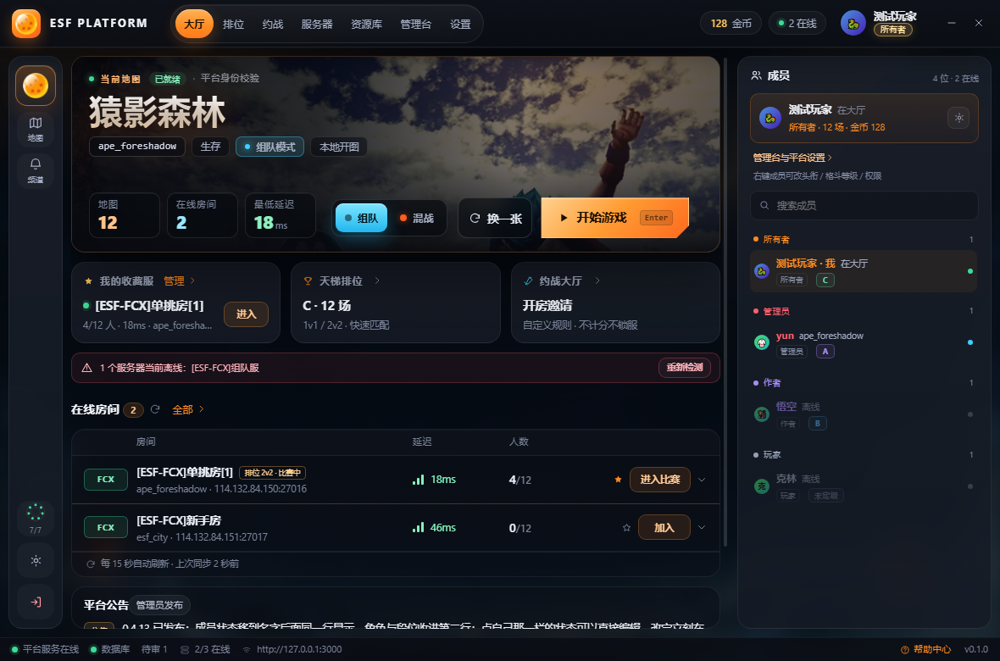
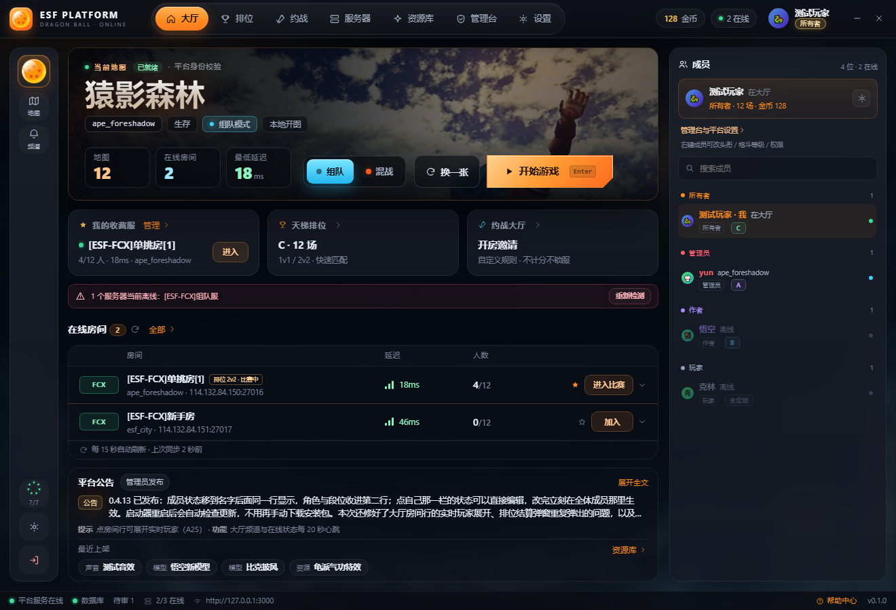
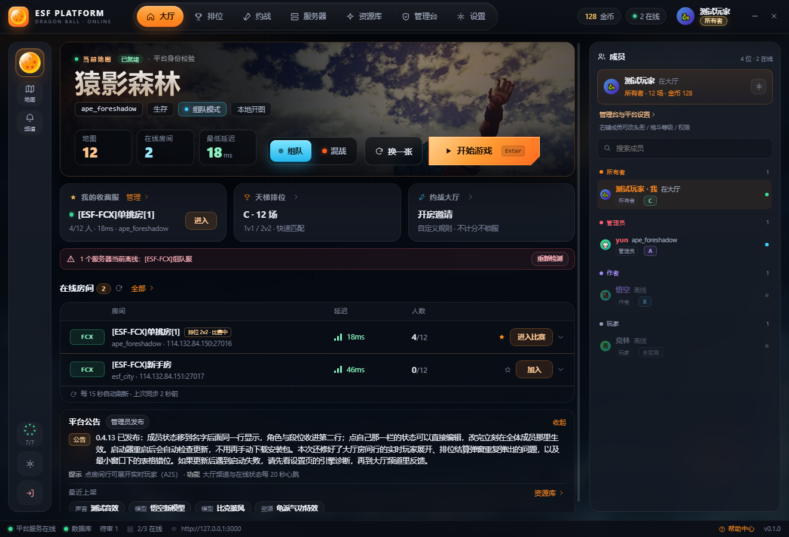

# P2 · 大厅内容

一句话：**先看地图，再看下一步，最后才是列表。** hero 被提到大厅最上面，用同一张实景图做裁切压暗；三张快捷卡压成等宽一行；房间表与公告共用一套卡片语言；整页竖向收紧到 1320×900 一屏装完。数据链路一行没改，改的是顺序、层级和密度。

## 改了什么

- **Hero**：44px 场景名 + 模式标签行（`组队` 青 / `混战` 橙）+ 三个 HUD（地图 / 在线房间 / 最低延迟）；底行是模式切换、换一张、开始游戏主 CTA，右下 15px 斜切角 + `Enter` 键提示
- **快捷三卡**：我的收藏服 / 天梯排位 / 约战大厅 等宽一行，信息压到一行——收藏卡只留「首个在线收藏」（房名 · 人数 · 延迟 · 地图）+ 进入按钮，排位卡直接显示段位与场次
- **在线房间表**：表头与数据行共用一套列宽（`58 / 1fr / 118 / 96 / 148`），房名、地图、信号条、人数、星标、加入按钮全部竖向对齐
- **公告合成一张卡**：公告（两行截断 + 展开/收起，按钮放在卡头右上，卡片高度不随展开跳动）→ 提示行 → 「最近上架」四个资源胶囊，点胶囊直达资源库；原来两列各占一半、底部常留空
- **一屏装完**：hero 226 / 快捷卡 98 / 离线提示 34 / 房间表 169 / 公告卡 168，1320×900 与 1468×941 两档实测 `scrollHeight === clientHeight`；更高窗口把余量摊到区块间距，不拉长任何一张卡
- **模式记忆**：上一次选的是组队还是混战，写进 `localStorage`，下次进平台直接沿用
- **1180 最小宽度**：顶栏导航 `white-space: nowrap`，并收窄 padding、隐藏图标与品牌副标题，不再竖排换行

## 为什么这样改

1. **大厅先回答「现在打哪张图」。** 玩家进来 1 秒内要找到的是开始按钮和当前地图，所以 hero 必须在快捷卡之上、占首屏最大面积；实景图负责给「这是游戏」的手感。
2. **快捷卡是「下一步」，不是「清单」。** 三张卡只放最可能的三个动作，信息压到一行；收藏服的完整列表本来就属于服务器页，大厅里只需要「最近常去的那一台」。
3. **表格对齐就是可信度。** 表头和数据行共用列宽后，延迟和人数可以竖着扫；之前表头右对齐、行内左对齐，扫读会错行。
4. **公告和上架都是「看板」，不需要两列争高度。** 合并成一张卡后，左半边的空档消失了，公告仍保持两行节奏；展开按钮放进卡头，展开/收起时整页高度不变。
5. **一屏是验收标准，不是审美偏好。** 大厅的最后一排（公告/上架）如果永远在折叠线以下，等于没做；所以按真实窗口高度反推每一块的高度，而不是让内容自然堆叠。
6. **模式选择记在本机。** 常打混战的人不该每次进来再点一次；本地存一个键，比在服务端存偏好更轻。

## 代码落点

| 文件 | 改动 |
| --- | --- |
| `src/App.css` | 末尾「P2 · 大厅」覆盖段：hero / 快捷卡 / 房间表 / 公告卡 / 一屏收紧 / 1240 断点 |
| `src/components/Lobby.jsx` | hero 重写（`.hero-art` + `.hero-mask` + `.hud` + `.hero-actions`）、快捷三卡替换旧 `.lobby-command`、公告折叠与「实际溢出」测量、模式记忆（`esf:localMode`）、按钮音效 |
| `src/components/ServerRoomList.jsx` | 结构未改，由覆盖层重排表头与行 |
| `scripts/mock-preload.cjs` | 补 `favorites` 与长公告，用于截图验证折叠与空态 |
| `scripts/shot.cjs` | 渲染等待 900ms → 1900ms；截图用独立 profile，不写真实客户端 localStorage |

## 前后对比

改造前（P1 外壳 + 旧大厅排布）：hero 在快捷卡下面，HUD 挤在右上角，收藏卡是一张 1.15fr 的大卡。

改造后（P2，真实客户端 1320×900）：hero 置顶、三 HUD 贴底、主 CTA 在右下，快捷三卡等宽，公告卡收在首屏底部。

最小宽度 1180×780：导航收成一行，快捷卡与房间表不横向溢出（高度不足时纵向滚动）。

长公告折叠态：超出两行才在卡头出现「展开全文」，展开后回到完整文本并变回「收起」，页面高度不变。

## 验收清单

- [ ] hero 主标题 44px，模式标签带颜色（组队青 / 混战橙），三个 HUD + 开始游戏主 CTA
- [ ] 快捷三卡等宽一行，信息一行可读（房名 / 段位 / 开房）
- [ ] 房间表表头与行内列对齐，信号条 + ms、人数、星标、加入按钮在同一列
- [ ] 公告与最近上架在同一张卡里，长公告可展开 / 收起且不改变整页高度
- [ ] 1320×900 与 1468×941 下大厅整页可见，无纵向滚动
- [ ] 1180px 下不横向溢出、导航不折行
- [ ] 组队/混战选择在重启后仍然保留
- [ ] `npx eslint .`、`node --test tests/`、`npm run build` 全绿

## 下一步

P3 排位页：把「未定级 → 黄金 III」的段位进度、最近战绩和匹配入口放进同一屏，继续沿用这套卡片与 HUD 语言。
