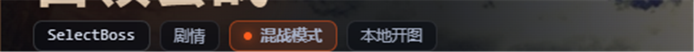
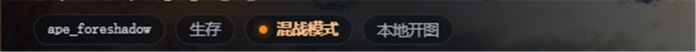
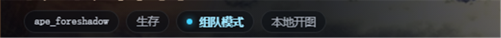
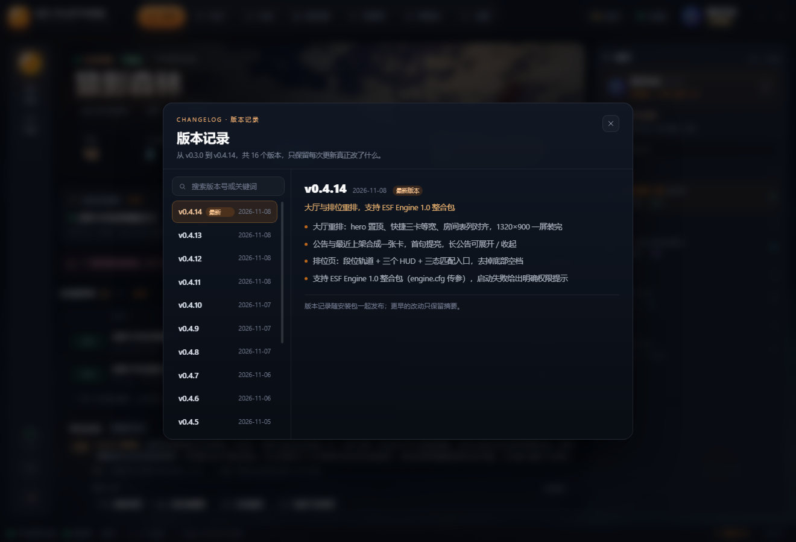
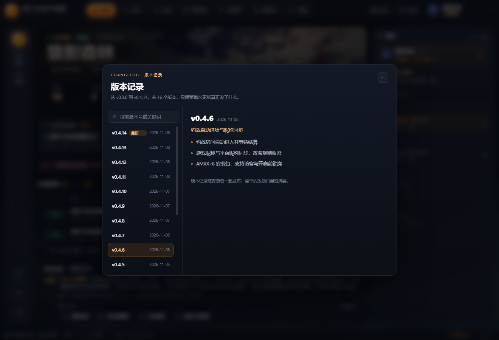

---
title: "P2.1 · 标签与版本记录"
subtitle: "一条标签规则收住颜色；一个查得到每次改了什么的地方"
kicker: "DESIGN SYSTEM · P2.1"
date: "2026.11.08"
author: "ESF 平台"
---

# P2.1 · 标签与版本记录

一句话：**颜色只给「状态点 + 状态词」，盒子只留一套。** 模式标签不再单独填橙底橙边，和左右邻居同高同底，只有点和字带颜色；版本记录把 16 个版本的更新收进一个可检索的弹层，入口在公告卡头和状态栏版本号，打开时不改变大厅高度。

## 改了三个地方

- **标签统一一套底**：24px 高、胶囊圆角、9% 白描边、50% 深底、11.5px 字；地图 code 稍亮，其余同色
- **模式标签只给颜色**：不再填橙色底、加橙色边，改成**橙点 + 橙字**，盒子跟邻居一模一样；组队是青点 + 青字
- **段位标签跟着同一套**：排位 hero 的段位标签用中性底，黄色只落在文字上

### 版本记录：左列表 + 右详情

- 新弹层，16 个版本（0.3.0 → 0.4.14），每版 2–4 句精简条目，最新的排最前
- 左侧搜索框可按版本号、日期、关键词过滤（输入「排位」只剩 4 个版本）
- 当前版本打「当前」标；开发版号不在列表里时，最新那条打「最新」
- 两个入口：公告卡头的「版本记录」、状态栏右下角的版本号；Esc 或点遮罩关闭

### 入口不打断大厅

- 弹层是覆盖层，不改变大厅高度：1320×900 仍是一屏，`scrollHeight = clientHeight`

## 为什么这样改

1. **只有一个标签被填色，视线会先被那块「补丁」吸走。** 左右邻居都是灰底，中间一块橙底橙边，看起来像贴上去的；把颜色压到点和字上，重量回到同一层。
2. **颜色不能丢。** 组队/混战本来就要一眼分得清，所以保留色相，只去掉色块；两个标签并排也不会互相抢。
3. **版本记录是「事后查询」，不是打扰。** 只在要点时打开，两栏比一条长滚动更好扫；搜索解决「我记得有个版本改过这个」。
4. **数据随包发布。** 版本条目放在 `src/data/releases.json`，离线可查、不依赖后端；下次发版改一份 JSON 就行。
5. **弹层不占版式。** 大厅已经压到一屏，再加一块内容会破功，所以版本记录做成覆盖层。

## 代码落点

| 文件 | 改动 |
| --- | --- |
| `src/App.css` | 标签统一（`.hero-tags .tag`、`.tag--team`、`.tag--dm`、`.ranked-hero .tag--rank`）+ 版本记录弹层约 30 条规则 |
| `src/components/ReleasesModal.jsx` | 新组件：列表 / 详情 / 搜索 / Esc / 当前或最新标记 |
| `src/data/releases.json` | 16 个版本的 `{version,date,summary,items[]}` |
| `src/components/Lobby.jsx` | `releasesOpen` 状态、公告卡头入口、状态栏版本号按钮 |
| `scripts/shot.cjs` | 截图脚本加 `--type`、`--probe`，profile 改为每进程独立，避免连续截图抢缓存卡死 |

**可以看到的东西**：标签的颜色规则、弹层的两栏结构、搜索过滤、当前/最新标记，都能在这份页面和截图里核对；版本条目本身是文案，随时可改。

## 前后对比

### 标签：从「一块补丁」到「一个状态点」

### 版本记录：列表 + 详情

## 验收清单

- [ ] 四个标签同一高度、圆角、描边、底色，只有点与字变色
- [ ] 组队青、混战橙在 1180 / 1320 两档都成立
- [ ] 版本记录列出 16 个版本，点条目右侧切换
- [ ] 搜索按版本号、日期、关键词都能过滤
- [ ] Esc、遮罩、右上角关闭都能退出弹层
- [ ] 大厅仍是一屏：1320×900 `scrollHeight = clientHeight`
- [ ] `eslint .` / `node --test tests/` / `npm run build` 全绿

## 下一步

P4 从约战页开始：它现在还是「左侧说明 + 右表单」的旧结构，按同一套 hero + 卡片的语言改，再往下是服务器、军备库、设置、管理台。
