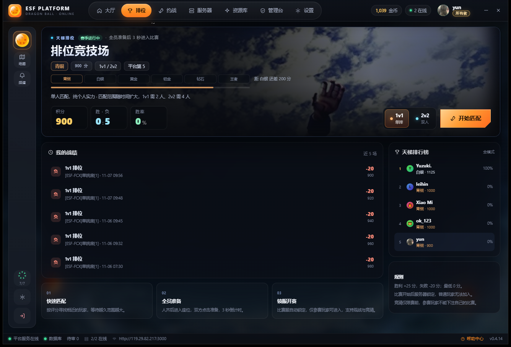
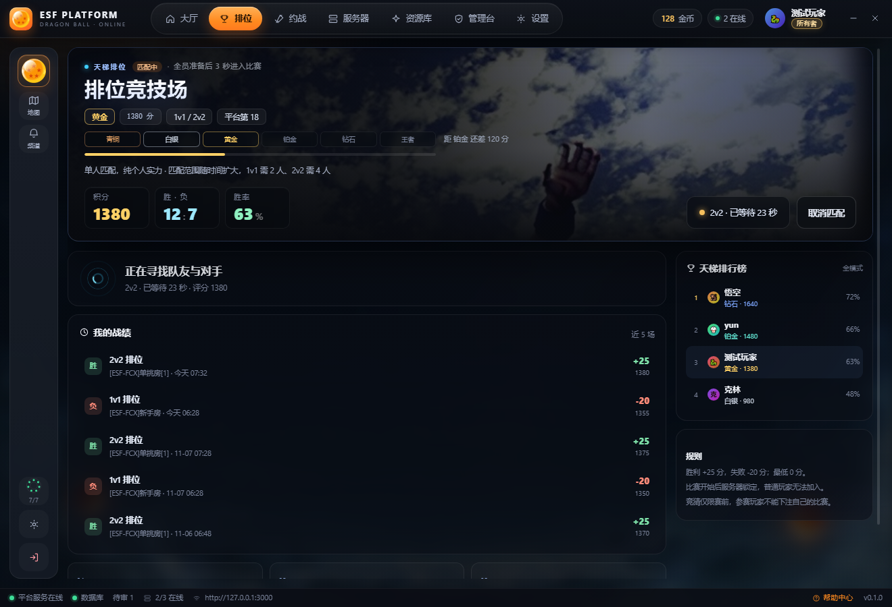
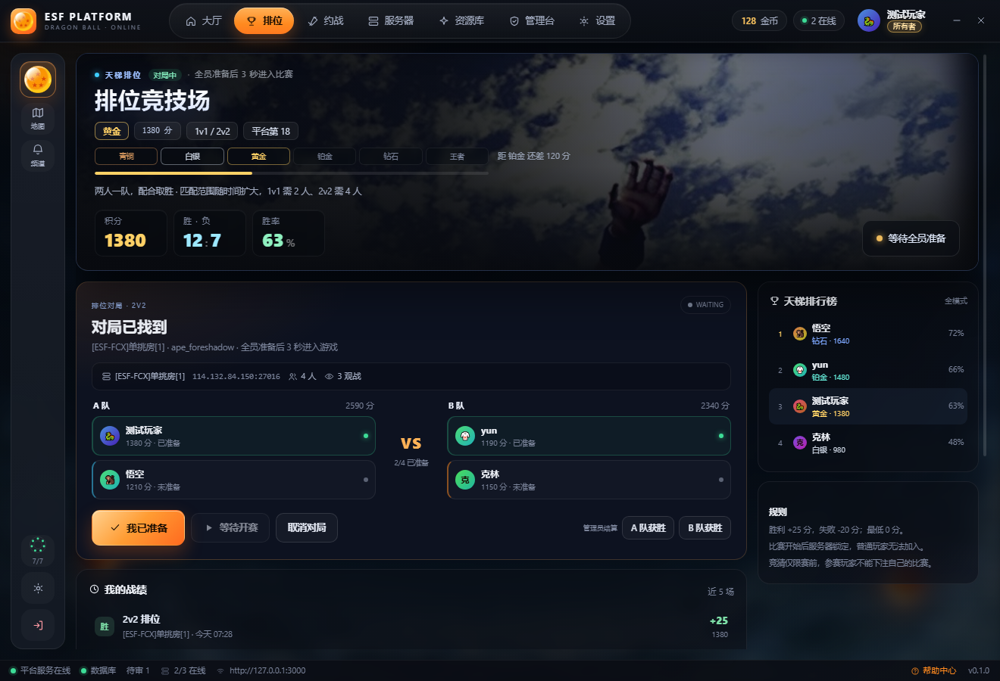
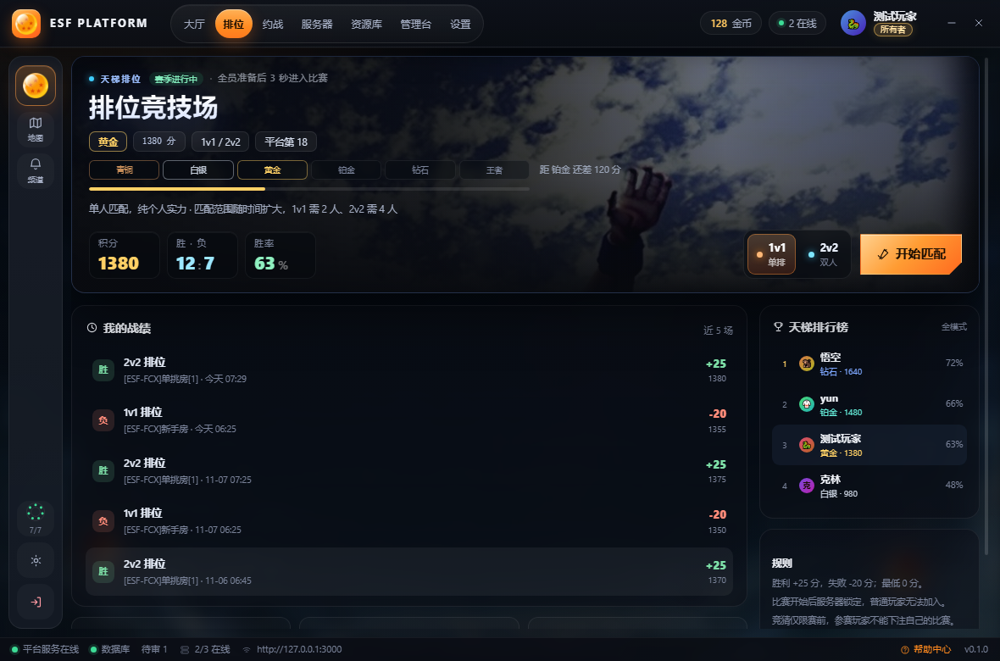

# P3 · 排位页

一句话：**先看段位，再看战绩，最后才开下一场。** 排位页原来的结构是「标题 + 右侧资料卡 → 模式卡 → 整宽按钮 → 独立段位卡 → 流程卡」，玩家要往下滚才能拼出「我在哪一段、离下一段还差多少」。P3 把这些压进一个 hero：段位进度条贴在标题下面，三个 HUD 说明积分、胜负、胜率，右下角是模式切换和开始匹配。

## 改了什么

- **Hero**：44px「排位竞技场」+ 段位标签（青铜 / 黄金 …，颜色跟段位走）+ 赛季状态；下面一条六段段位轨道与 4px 进度条，右侧写「距白银还差 200 分」；底行左侧三个 HUD（积分 / 胜·负 / 胜率），右侧 1v1 / 2v2 切换 + 开始匹配 CTA
- **三种状态共用一套 hero**：空闲时底行是模式切换 + 开始匹配；匹配中换成「2v2 · 已等待 23 秒」chip + 取消匹配；对局已找到换成「等待全员准备」chip，页面其余部分由主体区的对局板接管
- **战绩**：从「胜/负 + 2v2 · ape_foreshadow」改成四列可扫——胜/负色标、`2v2 排位`、`服务器 · 相对时间`、右侧 `+25 / 现分`；整行可点开结果弹窗
- **主体两列**：左侧战绩 + 流程说明，右侧排行榜（最多 12 行）与规则；匹配中时雷达条占住对局板的位置，页面不跳动
- **1180 最小宽度**：hero 压到 228 高、标题 40px、HUD 21px，右列保留 260px，排行榜与规则仍在首屏右侧

## 为什么这样改

1. **段位是这个页面唯一的主语。** 原来的段位信息散在两张卡里（赛季进度、右侧资料卡），现在收成「段位标签 → 轨道 → 差多少分」一条线，标题下第一眼就是它。
2. **战纪要能竖着扫。** 每行只保留四列固定语义，色标在最左，分差与现分在最右；地图 code 从标题里拿掉，退到副行——它是细节，不是行标题。
3. **匹配的三个状态不该换页面。** 空闲、匹配中、已找到都还是同一个 hero，只换底部动作区和主体区，玩家的视线不需要重新找锚点。
4. **沿用大厅的语言，而不是新造一套。** hero 的实景裁切、压暗遮罩、HUD 格子、切角 CTA 都是 P2 已经建立的类（`.hero-art` / `.hero-mask` / `.hud` / `.hero-cta`），排位只覆盖尺寸与配色，两页看起来是同一个平台。

## 代码落点

| 文件 | 改动 |
| --- | --- |
| `src/components/RankedPage.jsx` | 整页重写（747 行）：hero、段位轨道、三 HUD、三态动作区、战绩列表；轮询与 queue / ready / bet / spectate / finish 全部保留 |
| `src/App.css` | 末尾新增「P3 · 排位」覆盖段，约 660 行：hero / 段位轨道 / HUD / 模式切换 / 状态 chip / 队列条 / 战绩 / 排行榜 / 1240 断点 |
| `scripts/mock-preload.cjs` | 补 `ranked.history` 五行战绩（胜/负交替、含分差与前后分），用于截图验证列表 |

## 三种状态

空闲态（真实客户端 1336×908，青铜 900 分、5 场战绩）：段位轨道、三个 HUD、模式切换与开始匹配同屏。后两张用模拟数据（黄金 1380）复现匹配中与对局已找到，版式与真实客户端一致。

匹配中：hero 换成「2v2 · 已等待 23 秒」+ 取消匹配，主体顶部是一条雷达条，战绩仍在原位。

对局已找到：hero 换成「等待全员准备」，主体换成 A/B 队座位、已准备计数与操作按钮。

最小宽度 1180×780：hero 高度与字号收缩，右列保留排行榜与规则，不出现横向溢出。

## 验收清单

- [ ] 段位进度（段位标签 + 轨道 + 距下一段分数）在首屏、标题正下方
- [ ] 三个 HUD（积分 / 胜负 / 胜率）与模式切换、开始匹配 CTA 同屏
- [ ] 战绩每行四列对齐：胜/负色标、模式、服务器 · 时间、分差 / 现分
- [ ] 匹配中与对局已找到只换动作区和主体区，hero 结构不变
- [ ] 1180px 下 hero、HUD、CTA 不溢出，排行榜与规则仍在右列
- [ ] `npx eslint .`、`node --test tests/`、`npm run build` 全绿

## 下一步

P4 其余页：约战 / 服务器 / 军备库 / 设置 / 管理台。约战页现在还是「左侧说明 + 右侧表单」的旧排版，服务器页与军备库仍是密集列表，按 P2/P3 这套 hero + 卡片语言逐页收口。
