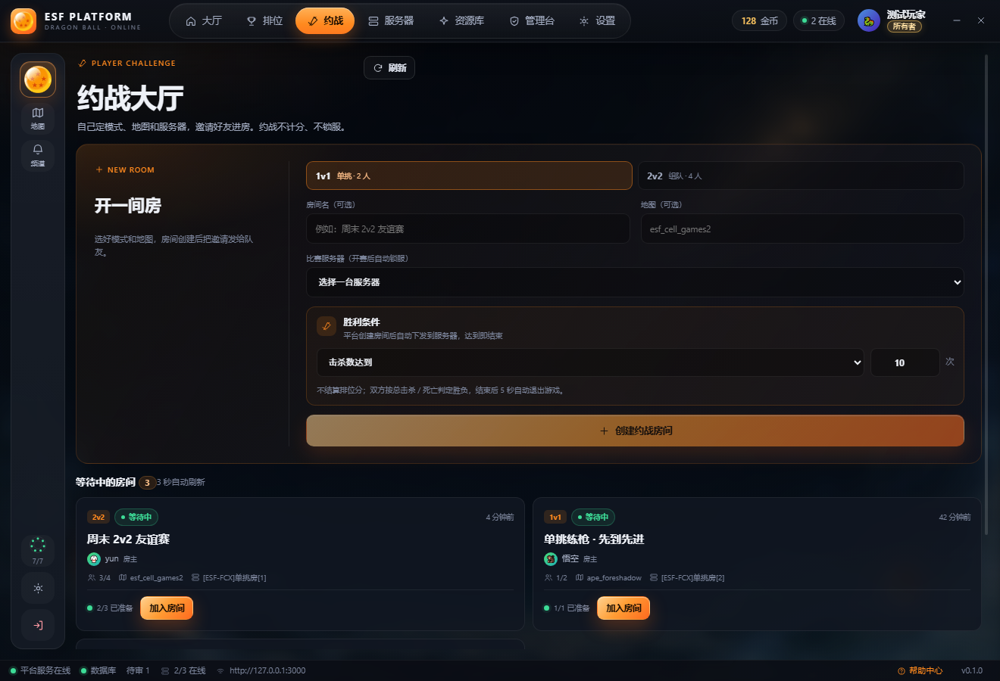
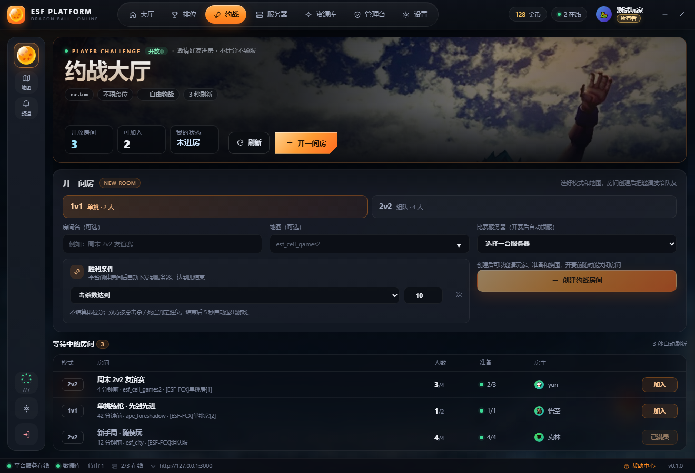
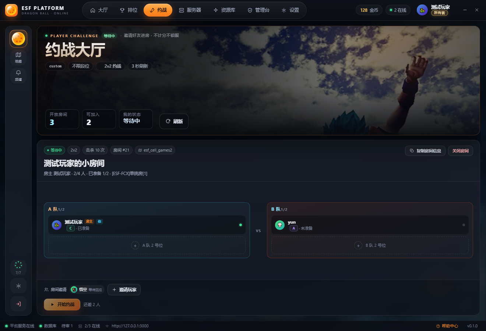
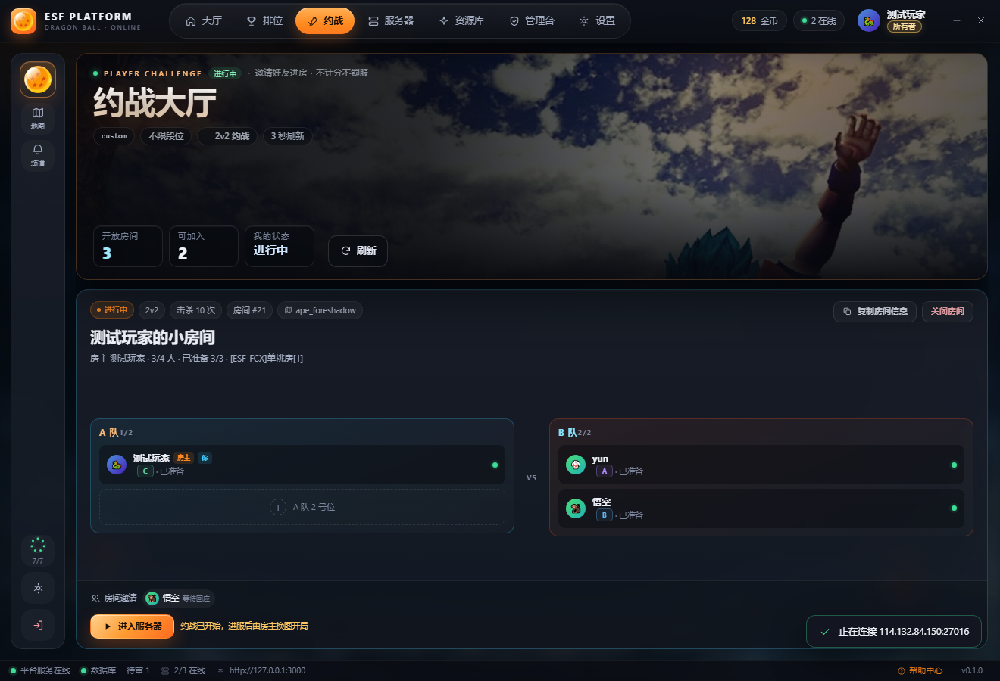
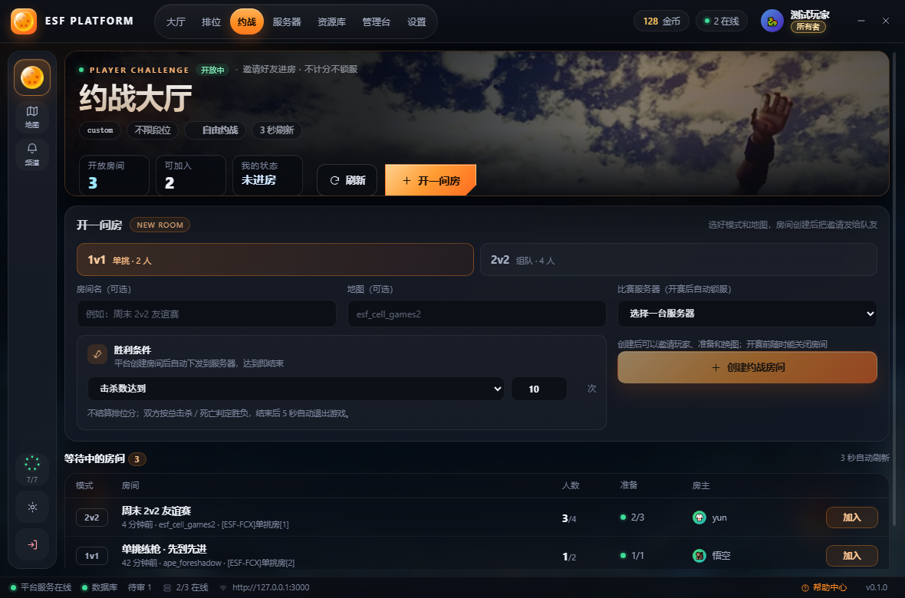

# P4 · 约战页

一句话：**约战页和排位页长成了同一套。** 页首是同一张 hero（三格 HUD + 刷新 + 开一间房），创建区压成一张卡里的三行，房间从卡片网格换成和在线房间同一张表；进房后不再是「一栏到底」的长卡，而是「顶栏信息 + 两栏对位 + 一条底栏」。

## 改了三个地方

- **hero 复用**：42px 标题、三格 HUD（开放房间 / 可加入 / 我的状态）、右侧「刷新 + 开一间房」；状态词跟着房间状态走（未进房 / 等待中 / 进行中）
- **创建区压成三行**：模式切换跨整行；房间名 / 地图 / 服务器一行三格；胜利条件占两格，创建按钮和说明占第三格
- **房间列表换表**：卡片网格 → 与在线房间同构的六列表格（模式 / 房间 / 人数 / 准备 / 房主 / 加入），满员行显示「已满员」

### 房内：顶栏信息 + 两栏对位 + 底栏操作

- 顶栏：状态点、模式、胜条件、房号、地图在左，复制房间信息 / 关闭房间在右
- 中间：A / B 两队并排，空位是虚线座位；VS 落在两栏正中
- 底栏：邀请条 + 操作（开始约战 / 进入服务器 / 还差几人）

## 为什么这样改

1. **三个页面共用一张 hero。** 玩家换页时不用重新认版式，只需要认「这一页的主数据是哪三个数」：大厅是地图 / 房间 / 延迟，排位是积分 / 胜负 / 胜率，约战是开放房间 / 可加入 / 我的状态。
2. **表比卡片快。** 模式在最左、人数和准备在中间、动作在最右，一列一列对下来即可；同样的信息放进卡片要读三行，而且卡片一多就没有横向对齐。
3. **创建表单是「填完就走」。** 能一行填完的绝不分成两行，创建按钮和说明并排落在最后一格，不再单独占一条底栏。
4. **房内页的重点是「谁在、还差谁」。** 所以两队放正中、底部只留操作；空位用虚线，一眼看出还差几个。
5. **一屏装完。** 列表态 1320×900 `scrollHeight = clientHeight`；房间态由 hero 吃掉剩余高度（最高 320px），底部不留空洞，也不把座位拉成一整片空场。

## 代码落点

| 文件 | 改动 |
| --- | --- |
| `src/components/ChallengePage.jsx` | hero 换版、创建区改 `section-head` + 三行表单、房间列表改六列表格、房内顶栏 / 对位 / 底栏重排、`focusCreate()` 滚到表单并聚焦 |
| `src/App.css` | 追加「P4 · 约战页」段约 240 行：hero 尺寸、创建卡三列、表格六列、房内分区、1180 断点 |
| `scripts/mock-preload.cjs` | `challenges` mock：3 间房 + `challenge-room` / `challenge-live` / `challenge-invite` 三种场景 |
| `scripts/shot.cjs` | `nth:<i>:<css>` 按下标点击、`--trace`、`backgroundThrottling:false` + alwaysOnTop + 先丢一帧，修「切页后截图还是旧帧」 |

**可以看到的东西**：三种形态（列表 / 等待中 / 进行中）、六列表格、三行表单、1180 断点，都能在截图里核对；表单字段和动作本身没动。

## 前后对比

### 列表：从「左说明右表单 + 卡片网格」到「三行表单 + 一张表」

### 房内

### 最小宽度

## 验收清单

- [ ] hero 与大厅 / 排位同款：42px 标题、三格 HUD、右侧刷新 + 主 CTA
- [ ] 创建区三行：模式 / 房间名·地图·服务器 / 胜利条件 + 创建
- [ ] 房间表六列对齐，满员行禁用「加入」并显示「已满员」
- [ ] 房内 A / B 两栏 + 居中 VS，空位为虚线座位
- [ ] 1320×900 列表态一屏：`scrollHeight = clientHeight`
- [ ] 1180 宽不横向溢出，导航仍是一行
- [ ] `eslint .` / `node --test tests/` / `npm run build` 全绿

## 下一步

P5 服务器页：现在还是「筛选 + 服务器卡列表」，按同一套路改成「hero + 一行筛选 + 一张表」，再把军备库 / 设置 / 管理台收进同一套卡片语言。
