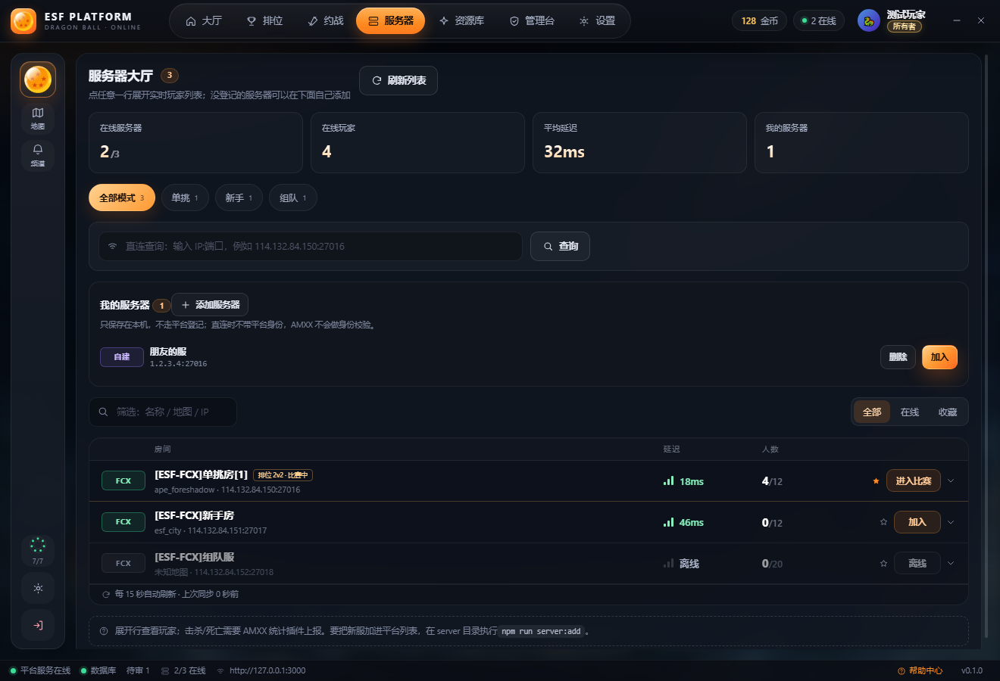
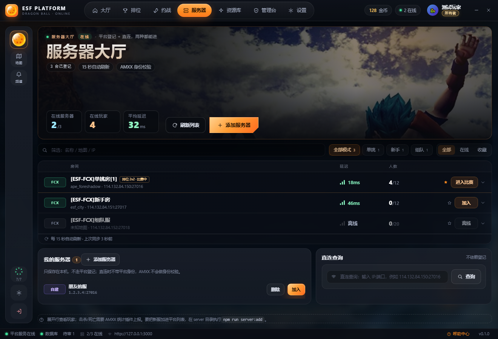

# P5 · 服务器页

一句话：**服务器页从「一堆控件」变成「一张表 + 两栏底」。** 页首换成和前三页同款 hero（三格 HUD 是这台平台此刻的三个数），模式 chips、搜索、全部/在线/收藏压成一行；直连查询从页面中间挪到底部右侧，和「我的服务器」并排；中间只留一张在线房间表。

## 改了三个地方

- **hero 收口**：42px 标题、三格 HUD（在线服务器 `2/3` / 在线玩家 / 平均延迟）、右侧「刷新列表 + 添加服务器」；原来四个统计格只留三个，第四个「我的服务器」并进左下角那张卡
- **一行筛选**：搜索 + 模式 chips + 全部/在线/收藏 三段，同高 34px 排成一行；模式 chip 只保留计数，不再单独占一整行
- **两栏底**：左「我的服务器」（列表 + 内联添加表单，点 hero 的添加按钮直接展开并聚焦），右「直连查询」（IP:端口 → 查询）；两条和表格同一套卡语言

### 表格对齐

- 表头与行共用五列：`58px · 1fr · 118px · 96px · 148px`（房间 / 延迟 / 人数 / 星标 / 动作）
- 延迟信号条与 ms 同格右对齐，人数左对齐；离线行整行降灰，按钮禁用显示「离线」

## 为什么这样改

1. **统计格并进 hero。** 四个格子占掉 200px，但玩家真正看的是「有没有人、快不快」；把「我的服务器」挪到它对应的卡片旁边，hero 就能同时承担「这页是什么」和「现在怎么样」。
2. **筛选必须一行。** 模式、状态、搜索是三个正交维度，分成三行会让表格下移一大截；压成一行后，1320×900 能完整看到三行房间 + 底部两栏。
3. **直连查询是低频动作。** 它不属于「浏览列表」这条主路径，放右下角，和「我的服务器」一起构成「手动维护」区；两个入口都写清楚「不依赖登记 / 只保存在本机」。
4. **页面内不加第二层容器。** 这一页不再套一张带边框的大卡（`.hall` 的 padding / border / blur 全部清掉），hero、表格、两栏直接落在大厅同一层背景上，和 P2 / P4 的页面观感一致。
5. **一屏装完。** 1320×900 下 `scrollHeight = clientHeight`；hero 用 `flex:1` 吃掉余量（200–300px），底部提示行贴底，不出现悬空空白。

## 代码落点

| 文件 | 改动 |
| --- | --- |
| `src/components/ServerHall.jsx` | 顶部改 hero（三格 HUD + 刷新 + 添加服务器）、筛选压成 `.servers-filters` 一行、房间表上移、底部改 `.servers-foot` 两栏、`openCustom()` 展开并聚焦添加表单 |
| `src/App.css` | 追加「P5 · 服务器页」段约 250 行：`.hall.servers-page` 去容器、hero 尺寸与裁切、`.servers-filters` / `.hall-mode` / `.segmented` 统一 34px、`.servers-foot` 两栏、`.custom-form` 三列、1180 断点 |
| `scripts/shot.cjs` | 没改：P4 加的 `nth:<i>:<css>` 点击和「切页先丢一帧」正好够用，P5 截图直接复用 |

**可以看到的东西**：hero 三格数值、一行筛选、五列表格、两栏底、1180 断点，截图里都能核对；查询 / 添加 / 收藏 / 加入这些动作本身没动。列对齐是量出来的：表头「延迟」在 `x=876`，行内信号条也在 `x=876`；「人数」`1006` 对 `1006`。

## 前后对比

### 整页

### 添加服务器

### 最小宽度

## 验收清单

- [ ] hero 与大厅 / 排位 / 约战同款：42px 标题、三格 HUD、右侧刷新 + 添加服务器
- [ ] 搜索 / 模式 chips / 全部·在线·收藏 同一行，34px 同高
- [ ] 表格五列对齐：表头「延迟 / 人数」与行内信号条、人数同一列
- [ ] 底部两栏：「我的服务器」可内联添加，「直连查询」保留 IP:端口 查询
- [ ] 1320×900 一屏：`scrollHeight = clientHeight`
- [ ] 1180 宽不横向溢出，导航仍是一行
- [ ] `eslint .` / `node --test tests/` / `npm run build` 全绿

## 下一步

P6：军备库 / 设置 / 管理台还各有各的版式，按同一套 hero + 表格语言收一遍；之后是发布前的整包回归（窗口最小尺寸、空态、错误态、深浅两套质感）。
